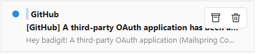

# Narrow Thread Actions

Adds Archive and Trash buttons when you hover over a thread in Mailspring's narrow list.
Tested on Mailspring 1.26.0 for Windows.

Windows notifications for individual messages also include a Delete button.
It moves the thread to Trash. Mark as Read and Archive remain available.
Reload Mailspring after updating; the new button appears in subsequent notifications.



## Installation

Run these commands in PowerShell:

```powershell
git clone https://github.com/badigit/mailspring-narrow-actions.git
Set-Location "mailspring-narrow-actions"
powershell -NoProfile -ExecutionPolicy Bypass -File ".\install.ps1"
```

Reload the Mailspring window from the Developer menu.
The command sets the execution policy only for that PowerShell process. Organization policies may still block scripts.
Hover over a thread in the narrow list.
Archive and Trash buttons appear on the right when those actions are available in the current folder.

## Troubleshooting

Open `%APPDATA%\Mailspring\packages\narrow-thread-actions\status.json`.
The value `state: active` means the plugin has loaded.
Check that `updatedAt` matches your latest window reload; an older value describes a previous session.
The value `state: installed` means installation finished and the window still needs a reload.
If the value is `state: failed`, the `error` field contains the failure details.

## Removal

Delete `%APPDATA%\Mailspring\packages\narrow-thread-actions`.
Reload the Mailspring window.

## Tests

Run this command from the repository directory:

```powershell
npm test
```
